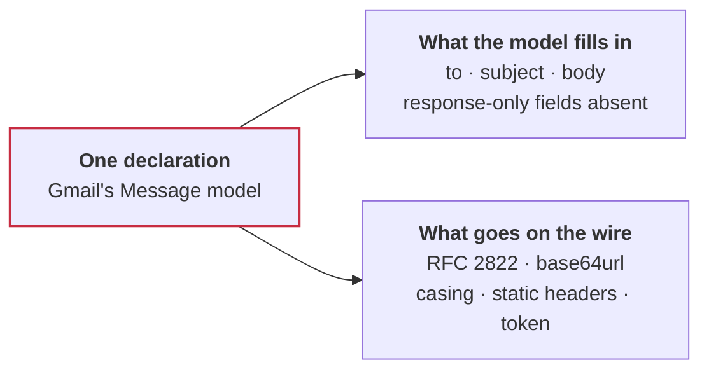

import AgentButton from '/snippets/agent-button.mdx';
import FrameworkHandoff from '/snippets/framework-handoff.mdx';

<AgentButton />

Charter is an open-source Python library for agents that act in your customers' accounts through APIs. Each tool is a Pydantic model that mirrors the API field by field, with your rules on top, and every call is checked against it before it's sent. Your app says whose account each call is for, and the model can't change it. The same declarations list everything each tool can reach, for code review and for your customer's security team. It works for any HTTP API, public or private.

**Charter is a library like Pydantic, not a service.** No signup, no middleman.

```bash
pip install charter-ai
```

The [quickstart](/start/quickstart) declares a tool for an API Charter has never seen, puts your rules on it, and shows a call refused before anything is sent.

## Whose account each call is for

An agent acting in a customer's account has to stay in that account, and only your app knows which one it is. A field marked [`FromContext()`](/reference/markers#fromcontext) is filled in by your app on every call and is absent from what the model sees, so a rule like "only this customer's charges" reads a value the model can't change. The [egress map](/boundary/egress-control) lists it beside everything else each tool can reach: commit it, and a change to what your agent can reach is a diff in review. [The quickstart does it.](/start/quickstart#act-for-one-customer)

## What the model sees and what gets sent can't disagree



The same declaration answers both questions, so they cannot disagree. A field
the model must not see is absent from the type it is handed, not filtered out of
a prompt afterwards.

Across 534 runs against live APIs, that surface produced none of the malformed GraphQL documents, undeclared endpoints or rejected base64 the raw arm did. Task success itself was a wash. [The full record, including the template that goes the other way.](/guarantees/measured-results)

[Read Why Charter for the full story.](/why-charter)

## Your rules, checked before the request

The declaration mirrors the API field by field, so your coding agent can check it against the docs for drift. Your own rules go on top, in the same Pydantic model: a cap, an allowlist, any check you can write in Python. A value can also be [pinned](/tools/projections#pin) out of the model's reach.

Every rule runs before any request. A call that breaks one never reaches the API: the model gets back [an error](/running/tool-validation-error-handling) naming the field and what it sent, so it can fix the call or stop. Charter never improvises, and since nothing touches the network, every rule can be tested offline with plain unit tests. [The quickstart breaks one on purpose.](/start/quickstart#break-a-rule)

## Plugs into what you run

The framework you already use decides when to call a tool, and [Charter makes the call](/using/adapters).

<FrameworkHandoff />

Gmail is one of seventeen APIs that ship [already declared](/packs/overview). For an API no pack covers, [your coding agent can write the declaration](/start/coding-agents#the-pack-writing-skill).

## What you get

<Columns cols={2}>
  <Card title="Open and direct" icon="unlock" href="/why-charter#compared-with-the-alternatives">
    Apache 2.0. Your process calls the API. No proxy, no per-call price, no rate limit but the API's own.
  </Card>
  <Card title="Egress control" icon="shield" href="/boundary/egress-control">
    A field the model must not see is absent from its schema, and the map is printable.
  </Card>
  <Card title="Deterministic wire" icon="ethernet" href="/tools/transforms">
    MIME, base64url, protobuf and casing are declared once and built by the runtime, never by the model.
  </Card>
  <Card title="Runs where you run it" icon="server" href="/why-charter#the-covenant">
    No telemetry, no phone-home, no training on your traffic. The only network calls are the API calls you define.
  </Card>
</Columns>

## Next

<Columns cols={2}>
  <Card title="Quickstart" icon="rocket" href="/start/quickstart">
    Declare a tool for any API, put your rules on it, watch one get refused, act for one customer.
  </Card>
  <Card title="Packs" icon="boxes" href="/packs/overview">
    Seventeen integrations, 687 tools, ready to configure and call.
  </Card>
  <Card title="Coding agents" icon="sparkles" href="/start/coding-agents">
    The skill that teaches your agent to declare tools for any API, and these docs as a source.
  </Card>
  <Card title="MCP server" icon="plug" href="/using/mcp">
    Compile a pack into a lean server that speaks the protocol.
  </Card>
</Columns>
