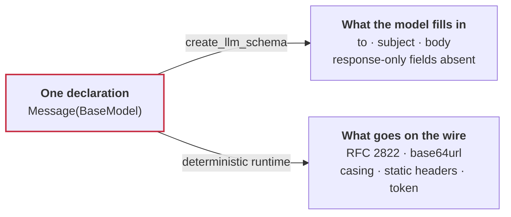

import AgentButton from '/snippets/agent-button.mdx';
import FrameworkHandoff from '/snippets/framework-handoff.mdx';

<AgentButton />

Charter is an open-source Python tool-definition layer for agents. Wire tools by hand and you're hoping for the best, blind spots and all. Vendor toolkits, MCP servers and catalog platforms hand you someone else's.

Charter lets you control every aspect of yours, and checks each call before it's sent. It works for any HTTP API, including your own internal ones.

**Charter is a library like Pydantic, not a service.** No signup, no middleman.

<div className="named-tabs" data-files="send_email.py|send_email.py">

<CodeGroup>

```python title="With Charter · 2 steps" highlight={10,17}
import asyncio
import os
from typing import Annotated

from pydantic import BaseModel
from charter import Body, EmailContent, Format, oauth_tool_factory
from charter.auth import OAuth2Client, OAuth2Server


# 1. Describe the args the LLM fills in
class SendEmail(BaseModel):
    raw: Annotated[
        EmailContent, Body(envelop=True), Format("rfc822_base64")
    ]


# 2. Say where the request goes, and whose grant it renews
google = OAuth2Server(
    issuer="https://accounts.google.com",
    authorization_endpoint="https://accounts.google.com/o/oauth2/v2/auth",
    token_endpoint="https://oauth2.googleapis.com/token",
)
gmail = oauth_tool_factory(
    pack="mygmail",
    base_url="https://gmail.googleapis.com/",
    provider="google",
    credential_provider=OAuth2Client(
        google,
        client_id=os.environ["GOOGLE_CLIENT_ID"],
        client_secret=os.environ["GOOGLE_CLIENT_SECRET"],
        refresh_token=os.environ["GOOGLE_REFRESH_TOKEN"],
    ),
)

send_email = gmail(
    name="send_email",
    description="Send an email.",
    method="POST",
    url_template="gmail/v1/users/me/messages/send",
    args_schema=SendEmail,
)

asyncio.run(
    send_email.ainvoke(raw={"to": "ada@example.com", "subject": "Hi", "body": "Hello"})
)
```

```python title="Without Charter · 5 steps" highlight={1,13,23,26,32}
# 1. Install google-auth, google-api-python-client
import base64
import os
from email.message import EmailMessage

from google.oauth2.credentials import Credentials
from googleapiclient.discovery import build
from googleapiclient.errors import HttpError


def send_email(to: str, subject: str, body: str) -> str:
    """Send an email."""
    # 2. Load the grant; google-auth renews the token when it expires
    creds = Credentials(
        None,
        refresh_token=os.environ["GOOGLE_REFRESH_TOKEN"],
        client_id=os.environ["GOOGLE_CLIENT_ID"],
        client_secret=os.environ["GOOGLE_CLIENT_SECRET"],
        token_uri="https://oauth2.googleapis.com/token",
    )

    try:
        # 3. Build the API client
        service = build("gmail", "v1", credentials=creds)

        # 4. Assemble the MIME document
        message = EmailMessage()
        message.set_content(body)
        message["To"] = to
        message["Subject"] = subject

        # 5. Encode, wrap in Gmail's envelope, send
        encoded = base64.urlsafe_b64encode(message.as_bytes()).decode()
        sent = (
            service.users()
            .messages()
            .send(userId="me", body={"raw": encoded})
            .execute()
        )
        return f'Message Id: {sent["id"]}'
    except HttpError as error:
        return f"An error occurred: {error}"


send_email(
    **{"to": "ada@example.com", "subject": "Hi", "body": "Hello"}
)
```

</CodeGroup>

</div>

Two steps against five, and one package to install against two, both starting from a refresh token your app's [consent flow](/auth/oauth-flow) already obtained. The difference that matters is who writes the wire. The model fills `to`, `subject` and `body` either way, and with Charter it never touches MIME or base64: [`Format("rfc822_base64")`](/reference/markers#format) builds the [RFC 2822](https://datatracker.ietf.org/doc/html/rfc2822) document and encodes it base64url, [`Body(envelop=True)`](/reference/markers#body) puts it under the `raw` key Gmail expects, and [`OAuth2Client`](/reference/oauth#oauth2client) renews the token and attaches it, the same way on every call, because [the schema already says what the request is](/tools/wire-contract). In [534 measured runs](/guarantees/measured-results), a raw HTTP tool sent base64 the API rejected four times; declared, it never did.

```bash
pip install charter-ai
```

## The schema is all you need



The same declaration answers both questions, so they cannot disagree. A field
the model must not see is absent from the type it is handed, not filtered out of
a prompt afterwards.

Across 534 runs against live APIs, that surface handed the model roughly four times less response context than a raw HTTP tool, and produced none of the malformed GraphQL documents, undeclared endpoints or rejected base64 the raw arm did. Task success itself was a wash. [The full record, including the template that goes the other way.](/guarantees/measured-results)

[Read Why Charter for the full story.](/why-charter)

## Your rules, checked before the request

The declaration mirrors the API field by field, so your coding agent can check it against the docs for drift. Your own rules go on top, in the same Pydantic model: a cap, an allowlist, any check you can write in Python. A value can also be [pinned](/tools/projections#pin) out of the model's reach.

Every rule runs before any request. A call that breaks one never reaches the API: the model gets back [an error](/running/tool-validation-error-handling) naming the field and what it sent, so it can fix the call or stop. Charter never improvises, and since nothing touches the network, every rule can be tested offline with plain unit tests. [The quickstart breaks one on purpose.](/start/quickstart#break-a-rule)

## Plugs into what you run

The framework you already use decides when to call a tool, and [Charter makes the call](/using/adapters).

<FrameworkHandoff />

Gmail is one of sixteen APIs that ship [already declared](/packs/overview). For an API no pack covers, [your coding agent can write the declaration](/start/coding-agents#the-pack-writing-skill).

## What you get

<Columns cols={2}>
  <Card title="Open and direct" icon="unlock" href="/why-charter#compared-with-the-alternatives">
    Apache 2.0. Your process calls the API. No proxy, no per-call price, no rate limit but the API's own.
  </Card>
  <Card title="Egress control" icon="shield" href="/boundary/egress-control">
    A field the model must not see is absent from its schema, and the map is printable.
  </Card>
  <Card title="Deterministic wire" icon="ethernet" href="/tools/transforms">
    MIME, base64url, protobuf and casing are declared once and built by the runtime, never by the model.
  </Card>
  <Card title="Runs where you run it" icon="server" href="/why-charter#the-covenant">
    No telemetry, no phone-home, no training on your traffic. The only network calls are the API calls you define.
  </Card>
</Columns>

## Next

<Columns cols={2}>
  <Card title="Quickstart" icon="rocket" href="/start/quickstart">
    Declare a tool for any API, put your rules on it, watch one get refused, pin a value.
  </Card>
  <Card title="Packs" icon="boxes" href="/packs/overview">
    Sixteen integrations, 613 tools, ready to configure and call.
  </Card>
  <Card title="Coding agents" icon="sparkles" href="/start/coding-agents">
    The skill that teaches your agent to declare tools for any API, and these docs as a source.
  </Card>
  <Card title="MCP server" icon="plug" href="/using/mcp">
    Compile a pack into a lean server that speaks the protocol.
  </Card>
</Columns>
